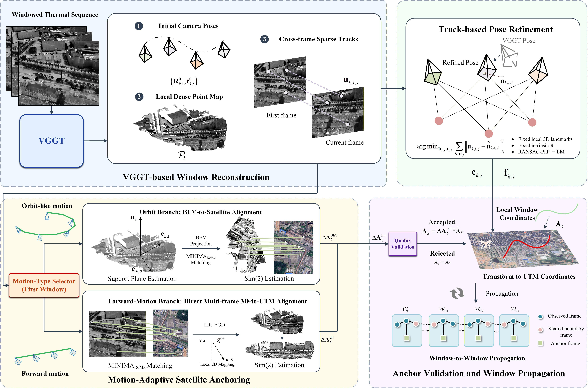
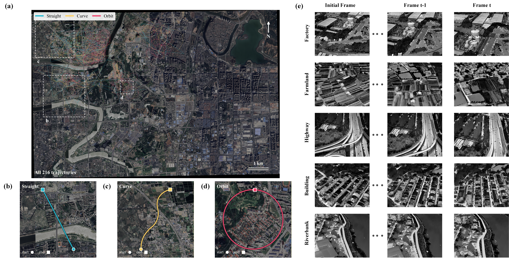

# ScalLoc: Continuous Oblique Thermal UAV Geo-Localization with a 2D Satellite Map

<p align="center">
  <strong>Xiaoran Zhang · Yu Liu · Jinyu Liang · Huaxin Xiao</strong>
</p>

<p align="center">
  <a href="https://arxiv.org/abs/2610.14866"></a>
  <a href="https://huggingface.co/datasets/FloralHercules/Thermal-Oblique"></a>
  <a href="https://github.com/FloralHercules/ScalLoc/stargazers"></a>
</p>

<p align="center">
  If you find our work useful, please consider giving us a ⭐️.<br>
  Your support means a lot to us! 🥰
</p>

<p align="center">
  <a href="https://arxiv.org/abs/2610.14866">Paper</a> ·
  <a href="https://arxiv.org/pdf/2610.14866">PDF</a> ·
  <a href="https://huggingface.co/datasets/FloralHercules/Thermal-Oblique">Dataset &amp; Weights</a> ·
  <a href="docs/README_zh.md">中文说明</a>
</p>

Official implementation of **ScalLoc**, a scale-aligned local-to-map framework for continuous oblique thermal UAV geo-localization. Given a thermal sequence and a geo-referenced **2D satellite map**, ScalLoc reconstructs local geometry, refines camera poses, anchors windows to the map, and propagates validated states to recover a global trajectory. No digital surface model or preconstructed 3D map is required.

## Framework

<p align="center">
  
</p>

ScalLoc combines four stages:

1. **Window reconstruction.** VGGT estimates camera poses, dense geometry, and cross-frame tracks from consecutive thermal images.
2. **Track-based pose refinement.** Fixed-intrinsics pose optimization improves the local trajectory using sparse tracks and fixed local 3D landmarks.
3. **Motion-adaptive satellite anchoring.** MINIMA-RoMa supplies cross-modal correspondences for BEV-to-satellite alignment or direct multi-frame 3D-to-map alignment, depending on the motion type.
4. **Validation and propagation.** Accepted map corrections align the local window to global coordinates; shared boundary frames transfer the state to subsequent windows.

The default configuration uses 12-frame windows with one-frame overlap, track-based refinement, and pitch/relative-height priors from the frame metadata. Perturbations are disabled by default.

In the [paper](https://arxiv.org/abs/2610.14866), ScalLoc achieves a frame-weighted mean position error of **26.97 m**, compared with **112.69 m** for the VGGT-only configuration (**76.07% reduction**). These are paper-reported results; the separate code-restructuring regression check is documented in [Reproducibility](docs/REPRODUCIBILITY.md).

## Thermal-Oblique Dataset

**Thermal-Oblique** contains **216 trajectories** and **28,112 thermal frames** with frame-level annotations. It covers urban and rural scenes, daytime and nighttime conditions, and straight, curved, and orbiting flight paths.

<p align="center">
  
</p>

### Download

- **Dataset, satellite map, and model checkpoints:** [Hugging Face — FloralHercules/Thermal-Oblique](https://huggingface.co/datasets/FloralHercules/Thermal-Oblique).
- **Placement instructions and checkpoint hashes:** [Data and weights guide](docs/DATA_AND_WEIGHTS.md).
- **Baidu Netdisk mirror:** coming soon.

The initial Hugging Face bundle is uploading as of October 14, 2026; download files become available once the upload is committed. The prepared ZIP contains the dataset, the Changsha satellite reference image, and all three required checkpoints. Data and weights are hosted separately from this code repository.

After downloading the bundle, extract its `data/` and `weights/` directories into the repository root:

```text
ScalLoc/
├── data/
│   ├── Thermal-Oblique/test/changsha/
│   │   └── <sequence>/
│   │       ├── Thermal/                 # Original thermal frames
│   │       └── Thermal_info.csv         # Frame-level metadata
│   └── maps/changsha/
│       └── ref.tif                      # Geo-referenced satellite map
└── weights/
    ├── vggt/model.safetensors
    ├── minima/minima_roma.pth
    └── dinov2/dinov2_vitl14_pretrain.pth
```

Keep the original frame filenames and metadata unchanged. `test/changsha` is the released directory organization, not a new geographically held-out split. The default pipeline does not read `dsm.tif`, so no DSM download is needed.

## Installation

```bash
git clone https://github.com/FloralHercules/ScalLoc.git
cd ScalLoc
```

Use an isolated Python environment. Install a matching **PyTorch/torchvision** pair for your CUDA environment, then install the remaining dependencies:

```bash
python -m pip install -r requirements.txt
```

The tested environment is **Python 3.12.9**, **PyTorch 2.6.0+cu126**, **torchvision 0.21.0+cu126**, and an **NVIDIA RTX 4060 Ti (16 GB)**. CUDA is strongly recommended. For the tested non-PyTorch dependency versions, use [`requirements-tested.txt`](requirements-tested.txt) instead of `requirements.txt`.

`run.py` works directly from the checkout. An editable installation is optional:

```bash
python -m pip install -e . --no-deps
```

## Checkpoints

The released configuration requires all three checkpoints:

| Model | Expected file | Role |
| --- | --- | --- |
| [VGGT](https://github.com/facebookresearch/vggt) | `weights/vggt/model.safetensors` | Window geometry, poses, and tracks |
| [MINIMA-RoMa](https://github.com/LSXI7/MINIMA) | `weights/minima/minima_roma.pth` | Thermal-to-satellite matching |
| [DINOv2 ViT-L/14](https://github.com/facebookresearch/dinov2) | `weights/dinov2/dinov2_vitl14_pretrain.pth` | Matcher backbone |

Use the files specified in the [asset guide](docs/DATA_AND_WEIGHTS.md) to reproduce the released configuration. Each checkpoint remains subject to its upstream terms.

## Run ScalLoc

Check that the dataset, map, and weights are available without loading the models:

```bash
python run.py --config configs/default.yaml --check
```

Run one complete sequence:

```bash
python run.py --config configs/default.yaml
```

The default sequence is `Rural_Day_Curve_H150_P30_S01` (138 frames); `max_windows: 0` processes the complete trajectory. To select another sequence or evaluate every available sequence:

```bash
python run.py --config configs/default.yaml --dataset Urban_Day_Orbit_H200_P40_S02
python run.py --config configs/default.yaml --all-datasets
```

For a one-window smoke test or a custom output directory:

```bash
python run.py --config configs/default.yaml --max-windows 1
python run.py --config configs/default.yaml --output-dir outputs/my_run
```

Use a fresh output directory for each run; existing non-empty directories are not overwritten. Detailed intermediate visualizations are disabled by default. Outputs include trajectory estimates, per-frame comparisons, and sequence metrics.

### Configuration and external resources

[`configs/default.yaml`](configs/default.yaml) defines resource paths and run options. [`configs/regions/changsha.yaml`](configs/regions/changsha.yaml) defines the map's geographic reference.

If data and weights are already stored on another disk, copy [`configs/local.example.yaml`](configs/local.example.yaml) to a private `configs/local.yaml`, replace the placeholder paths, and run:

```bash
python run.py --config configs/local.yaml --check
python run.py --config configs/local.yaml
```

There is no need to duplicate the assets. Relative paths resolve from the **repository root**, not the shell's working directory. See the [asset guide](docs/DATA_AND_WEIGHTS.md) for the full path layout.

## Project Structure

```text
ScalLoc/
├── run.py                    # Command-line entry point
├── configs/                  # Run options and geographic configuration
├── src/scalloc/              # Reconstruction, geometry, matching, and reporting
├── third_party/              # Required upstream inference modules and licenses
├── assets/                   # Method and dataset figures
├── data/                     # External dataset and map location
├── weights/                  # External checkpoint location
├── tests/                    # Interface and numerical-preservation checks
├── tools/                    # Release and regression-check utilities
└── docs/                     # Setup guide and reproducibility details
```

For the measured original-versus-restructured comparison and the commands to repeat it, see [Reproducibility](docs/REPRODUCIBILITY.md). For contributions, see [CONTRIBUTING.md](CONTRIBUTING.md).

## Citation

If you use ScalLoc or Thermal-Oblique in your research, please cite our paper:

```bibtex
@article{zhang2026scalloc,
  title   = {ScalLoc: Continuous Oblique Thermal UAV Geo-Localization with a 2D Satellite Map},
  author  = {Zhang, Xiaoran and Liu, Yu and Liang, Jinyu and Xiao, Huaxin},
  journal = {arXiv preprint arXiv:2610.14866},
  year    = {2026},
  url     = {https://arxiv.org/abs/2610.14866}
}
```

## Acknowledgements

We thank the authors of [VGGT](https://github.com/facebookresearch/vggt), [MINIMA](https://github.com/LSXI7/MINIMA), [RoMa](https://github.com/Parskatt/RoMa), and [DINOv2](https://github.com/facebookresearch/dinov2) for their work and released implementations.

## License

The project's own source-code license is pending; see [LICENSE_NOTICE.md](LICENSE_NOTICE.md). Third-party code and checkpoints retain their respective licenses, documented in [THIRD_PARTY_NOTICES.md](THIRD_PARTY_NOTICES.md). Dataset, map, and checkpoint permissions must be considered separately.
